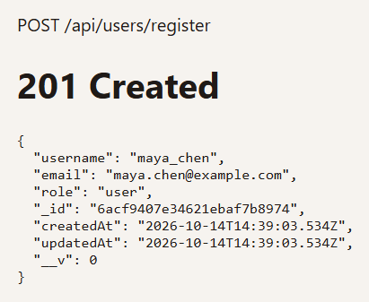
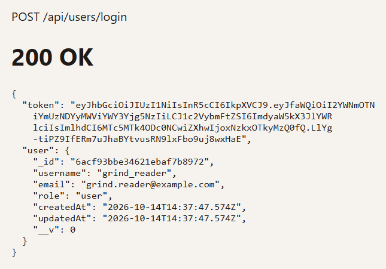
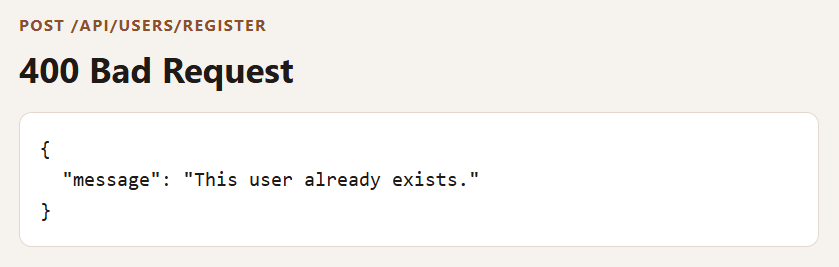
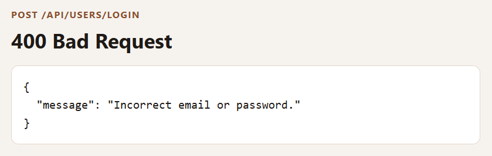
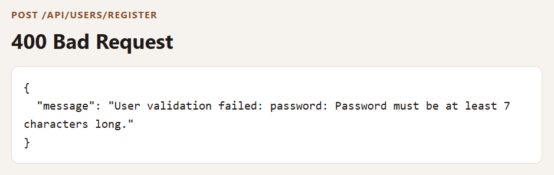

# Basic Login System

An Express API for creating an account and signing in. Users are stored in MongoDB. Passwords are hashed with bcrypt before they are saved, and a successful login returns a JSON Web Token that expires in one hour.

There is no HTML page. These screenshots are the JSON the API returned when the server was running.

## Screenshots

**Register.** `POST /api/users/register` creates the user and leaves the password out of the response. New users get the `user` role.



**Login.** `POST /api/users/login` checks the password and returns a token plus the public user.



**Duplicate email.** Registering an email that is already stored returns 400.



**Wrong password.** A bad email or password returns the same message, so the response does not reveal which one was wrong.



**Short password.** The password must be at least 7 characters.



## Getting started

```bash
npm install
npm start
```

The server reads `.env` and listens on `http://localhost:3000` unless `PORT` is set.

| Variable | Purpose |
| --- | --- |
| `MONGO_URI` | MongoDB connection string |
| `PORT` | Port for Express |
| `JWT_SECRET` | Secret used to sign login tokens |

| Command | What it does |
| --- | --- |
| `npm start` | Run the server with Node |
| `npm run dev` | Run the server with nodemon |

## Routes

Send JSON with `Content-Type: application/json`.

### `POST /api/users/register`

```json
{
  "username": "maya_chen",
  "email": "maya.chen@example.com",
  "password": "coffee123"
}
```

Returns `201` and the saved user, without the password. Returns `400` if the email is already registered, or if a required field is missing or too short.

### `POST /api/users/login`

```json
{
  "email": "grind.reader@example.com",
  "password": "coffee123"
}
```

Returns `200` with `token` and `user`. The token payload is the user id and username, and it expires in one hour. Returns `400` with `Incorrect email or password.` when the email is unknown or the password does not match.

## User fields

| Field | Rule |
| --- | --- |
| `username` | Required, unique, trimmed |
| `email` | Required, unique, must look like an email |
| `password` | Required, at least 7 characters, hashed before save |
| `role` | `user` or `admin`, defaults to `user` |
